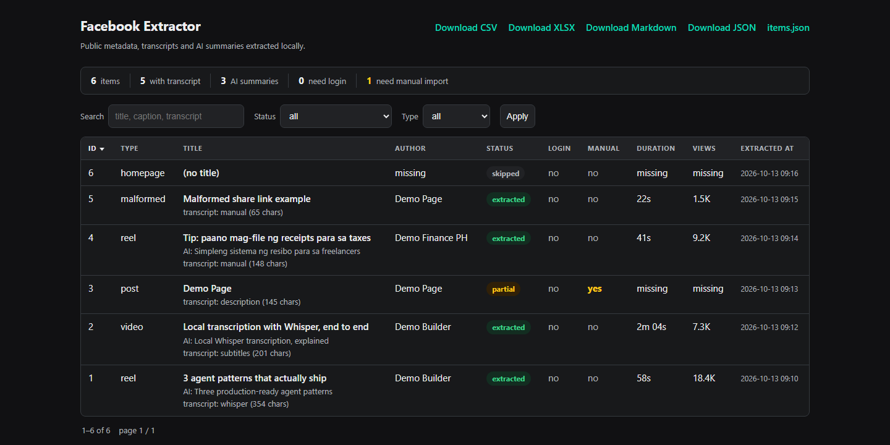
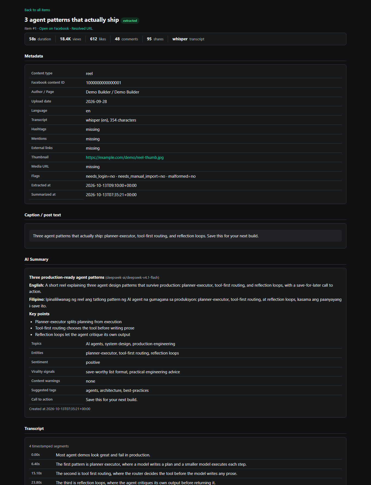
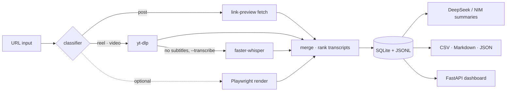

<div align="center">
  <picture>
    <source media="(prefers-color-scheme: dark)" srcset="docs/assets/logo-dark.svg">
    <source media="(prefers-color-scheme: light)" srcset="docs/assets/logo-light.svg">
    
  </picture>

**Local-first Facebook content extractor.** Give it links; it stores public metadata, captions and transcripts in SQLite, transcribes videos locally with Whisper when no subtitles exist, and writes bilingual Filipino/English AI summaries — browsable in a zero-JS dashboard that never leaves your machine.

[](LICENSE)
[](pyproject.toml)
[](#quality)
[](#quality)
[](https://github.com/jemimahbalintay-netizen/facebook-extractor/actions/workflows/ci.yml)

[Quickstart](#quickstart) · [Features](#features) · [Dashboard](#dashboard) · [Docs](docs/) · [Legal](#legal--ethics)

</div>

---

## What it is

A personal archiving and analysis tool for **publicly accessible** Facebook content: posts, reels and videos. You feed it URLs; it extracts what a browser or link-preview crawler would see, stores everything locally, and optionally asks DeepSeek (or any OpenAI-compatible endpoint, e.g. NVIDIA NIM) to summarize each item in **English and Filipino** with structured fields — topics, entities, sentiment, virality signals, content warnings.

## What it is not

- **Not a login-wall bypass.** If Facebook requires authentication, the item is flagged `needs_login` / `needs_manual_import` and you paste the text yourself.
- **Not a scraper farm.** One polite request at a time (`FACEBOOK_DELAY_SECONDS`, default 2s), retries with backoff, and it stops at anything non-public.
- **Not a cloud service.** No telemetry, no accounts, no data leaves your machine except the links you ingest, the media it downloads for transcription, and your configured AI endpoint.

## Features

| | |
|---|---|
| 🔎 **URL intelligence** | Classifies `post` / `reel` / `video` / `homepage` / `malformed`, repairs duplicated share paths, tries both candidates |
| 🎬 **Video & reel extraction** | yt-dlp under the hood: title, author, duration, views/likes/comments/shares, upload date, thumbnail, embedded subtitles |
| 📝 **Transcript priority** | embedded subtitles → local Whisper (`faster-whisper`) → caption fallback → manual import; junk/hallucinated captions are discarded automatically |
| 🔍 **Full-text search** | SQLite FTS5 index over titles, captions and transcripts — `main.py search "term"` with highlighted snippets, dashboard search box, `/items.json?q=` |
| 🔁 **Resilient re-runs** | content hashes detect stale summaries (`summarize --stale`), failed URLs retry in one command (`ingest --retry-failed`), cron-safe batches (`ingest --skip-existing`) |
| 🤖 **Bilingual AI summaries** | DeepSeek V4.1 Flash (NVIDIA NIM ready): English + Filipino summaries, key points, entities, sentiment, warnings; map-reduce for long transcripts |
| 🗄️ **Local storage** | SQLite (WAL) + append-only JSONL + verified backups (`scripts/backup_db.py`, SQLite backup API) |
| 📊 **Zero-JS dashboard** | FastAPI + server-rendered Jinja2 with search, sortable columns and pagination; strict CSP, no scripts, accessible dark UI (contrast machine-checked) |
| 📤 **Exports** | CSV, XLSX (items + summaries sheets) and JSON — all formula-injection guarded — plus a grouped Markdown report |
| 🛡️ **Production habits** | 242 offline checks, ruff + strict mypy, pre-commit, pip-audit, secret-safe layout, restore drills, CI on Linux + Windows |

## Screenshots

| All items | Item detail |
|---|---|
|  |  |

*(Screenshots use synthetic demo data — `python scripts/make_demo_db.py`.)*

## Architecture



## Quickstart

**Requirements:** Python 3.11+ (tested on 3.14) · ffmpeg on PATH (for transcription) · a DeepSeek API key or an NVIDIA NIM key (optional, for summaries).

```powershell
git clone https://github.com/jemimahbalintay-netizen/facebook-extractor.git
cd facebook-extractor

python -m venv .venv
.venv\Scripts\activate            # Linux/macOS: source .venv/bin/activate

pip install -r requirements.txt              # core
pip install -r requirements-optional.txt     # faster-whisper, langdetect, pre-commit

copy .env.example .env                        # then edit .env (see Configuration)

python scripts/init_db.py
python main.py ingest --file seed_urls.txt   # extract metadata + captions
python main.py export --format all
python main.py serve                          # http://127.0.0.1:8765
```

Exact pins of the verified environment ship in `requirements-lock.txt` if you want the byte-identical setup.

### Everyday commands

| Command | What it does |
|---|---|
| `python main.py ingest --all` | process every URL in `seed_urls.txt` |
| `python main.py ingest --url URL` | one URL (repeatable) |
| `python main.py ingest --all --transcribe` | also transcribe videos that lack subtitles (local Whisper) |
| `python main.py ingest --all --summarize` | also generate AI summaries |
| `python main.py ingest --retry-failed` | re-process URLs whose last extraction failed |
| `python main.py ingest --all --skip-existing` | only new and failed URLs (ideal for scheduled runs) |
| `python main.py summarize` | summarize stored items without re-fetching (`--all` re-does everything) |
| `python main.py summarize --stale` | re-summarize only items whose content changed since their summary |
| `python main.py search "term"` | full-text search across titles, captions and transcripts (`--json` supported) |
| `python main.py manual-import --url URL --text-file caption.txt` | paste content Facebook wouldn't serve publicly |
| `python main.py export --format csv\|xlsx\|markdown\|json\|all` | write exports into `data/` |
| `python main.py status` | totals, flags, tool availability, latest items |
| `python main.py serve` | local dashboard (search, sort, pagination built in) |
| `python scripts/backup_db.py` | WAL-safe verified backup (keeps the newest 10) |

## Dashboard

Server-rendered, script-free, dark, and fast: filterable item table with status badges, per-item pages with metadata, full caption, timestamped transcript, AI summary and raw JSON. Security headers (strict CSP, `nosniff`, `no-referrer`, `no-store`) are on by default, and it binds to `127.0.0.1` unless you explicitly say otherwise.

```powershell
python main.py serve                 # http://127.0.0.1:8765
python scripts/make_demo_db.py       # optional: build synthetic demo data to explore
$env:DATABASE_PATH="data/demo.db"; python main.py serve   # serve the demo DB
```

## Configuration

Everything lives in `.env` (see `.env.example`); the interesting ones:

| Key | Default | Purpose |
|---|---|---|
| `DEEPSEEK_API_KEY` | *(empty)* | enables AI summaries (DeepSeek or NVIDIA NIM `nvapi-…`) |
| `DEEPSEEK_BASE_URL` | `https://api.deepseek.com/v1` | NVIDIA NIM: `https://integrate.api.nvidia.com/v1` |
| `DEEPSEEK_MODEL` | `deepseek-v4.1-flash` | NVIDIA NIM: `deepseek-ai/deepseek-v4.1-flash` |
| `FACEBOOK_DELAY_SECONDS` | `2` | politeness delay between requests |
| `WHISPER_MODEL` / `WHISPER_LANGUAGE` | `small` / `auto` | local transcription (use `tl` for Tagalog-leaning audio) |
| `ENABLE_PLAYWRIGHT` | `false` | optional rendered-page fallback |
| `COOKIE_FILE` | `cookies.txt` | optional cookies **for your own authorized account** |
| `AUTO_SUMMARIZE` | `false` | summarize automatically during ingest |

## Data & privacy

- Everything is stored under `data/` (database, JSONL, exports, backups) and `logs/`; both are gitignored — **scraped content is never published with this repo**.
- `data/extracted.jsonl` is an append-only audit trail; `python scripts/compact_jsonl.py` keeps the newest record per URL.
- Your keys stay in `.env` (gitignored). The AI step sends only extracted text to your configured endpoint — nothing else.

## Quality

- **242 offline checks**: 93 unit (parsers/mapping/hashing), 83 audit (pipeline, search, security, data integrity), 66 dashboard (renders, headers, contrast, search/sort/pagination) — all runnable without network or real data.
- **Static analysis**: `ruff` 0 findings (documented ignores with rationale), `mypy` strict 0 errors across 32 files, `vulture` clean.
- **Supply chain**: `pip-audit` clean, `pip check` clean, exact-pin lockfile, pre-commit hooks (tag-pinned).

```powershell
python tests/unit_tests.py
python tests/audit_suite.py
python tests/dashboard_tests.py
pre-commit run --all-files     # after: pip install pre-commit && pre-commit install
```

## Legal & ethics

This tool retrieves **publicly available** content only, exactly like a browser or link-preview crawler. It does **not** bypass CAPTCHAs, defeat login walls, evade security controls, or access private content — and it never will.

- Meta's Terms of Service prohibit automated collection without permission; **use this only for content you own or are authorized to process**.
- Respect copyright and privacy laws (e.g. the Philippine Data Privacy Act, GDPR).
- If a URL needs a session, the tool flags it rather than fighting it. `cookies.txt` support exists **only** for your own authorized account.

See [`docs/AUDIT.md`](docs/AUDIT.md) and [`docs/RESEARCH.md`](docs/RESEARCH.md) for the full reasoning and citations. This is not legal advice.

## Docs

| Document | Contents |
|---|---|
| [`docs/SHIP_PLAN.md`](docs/SHIP_PLAN.md) | 20-item pre-ship gate, rollback, release steps |
| [`docs/ROADMAP.md`](docs/ROADMAP.md) | what shipped, what's next (v1.2 / v2.0), explicit non-goals |
| [`docs/AUDIT.md`](docs/AUDIT.md) | 4 audit rounds: findings, fixes, verified-safe areas, accepted risks |
| [`docs/TROUBLESHOOTING.md`](docs/TROUBLESHOOTING.md) | login walls, ffmpeg, whisper quality, API errors |
| [`docs/RESEARCH.md`](docs/RESEARCH.md) | yt-dlp/Meta/NIM/Whisper facts with primary sources |
| [`docs/ANTI_SLOP_RESEARCH.md`](docs/ANTI_SLOP_RESEARCH.md) | AI-slop failure classes and the pre-ship gate rationale |
| [`docs/DESIGN_AND_BACKEND_RESOURCES.md`](docs/DESIGN_AND_BACKEND_RESOURCES.md) | curated non-slop UI/UX + backend resources |

## License

[MIT](LICENSE) © 2026 Isaac G. Balintay

<div align="center"><sub>Built with care: ruff, mypy, 199 tests, and a healthy distrust of anything a crawler returns.</sub></div>
